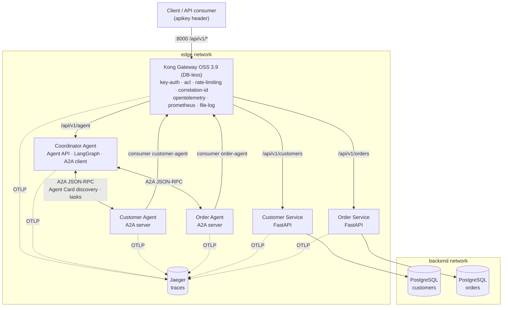

# ComCo Customer Service Integration Platform

Prototype for the *API Management, Agentic AI & Agent-to-Agent (A2A)* technical assessment.

> **Status: all three phases implemented** - backend APIs · API management with Kong (security,
> traffic control, correlation, tracing, logging, metrics) · Agentic API (LangGraph Coordinator) ·
> A2A delegation to a Customer Agent and an Order Agent (official `a2a-sdk`). See
> [Known limitations](#known-limitations) and [Incomplete functionality](#incomplete-functionality).

---

## Architecture



Only Kong (`:8000`), Jaeger UI (`:16686`) and Kong metrics (`:8100`) are published to the host.
Services, agents and databases are reachable only inside the compose networks, so every external
call passes through the API management layer.

### How the key scenario travels

*"Find customer C001 and tell me their latest order status."*

1. **Client → Kong** - `key-auth` identifies consumer `demo-client`, `acl` allows
   `external-clients` on `/api/v1/agent`, `rate-limiting` counts the call, `correlation-id` assigns
   `X-Correlation-ID`, `opentelemetry` starts the trace.
2. **Kong → Coordinator Agent** - LangGraph `plan_request` extracts `C001` + "latest order" and plans
   `get_customer(C001)` then `get_latest_order(C001)` (depends on the first).
3. **Coordinator → Customer Agent (A2A)** - the skill `get_customer` is found in the Customer Agent's
   Agent Card; an A2A task is sent (`SendMessage`, DataPart `{skill, args}`).
4. **Customer Agent → Kong → Customer Service → PostgreSQL** - the agent calls the managed API with
   its own key (consumer `customer-agent`, allowed on the Customer API only). Task `COMPLETED` with the
   customer as artifact.
5. The customer exists, so the dependent step runs: **Coordinator → Order Agent (A2A) → Kong → Order
   Service → PostgreSQL** (consumer `order-agent`). Task `COMPLETED` with order `O1003`.
6. **`compose_answer`** writes the answer from the two artifacts only and returns it with the plan,
   the A2A task IDs/states, the graph path, the raw data, the correlation ID and the trace ID.

One correlation ID and one trace cover every hop; see [Observability](#tracing-one-request).

### Architecture decisions

Each decision is recorded with context, options and trade-offs in `docs/adr/`:

| ADR | Decision |
|---|---|
| [0001](docs/adr/0001-service-boundaries.md) | Two services, database-per-service, versioned public paths at the gateway |
| [0002](docs/adr/0002-api-gateway-kong.md) | Kong Gateway OSS 3.9 (DB-less) as the API management layer |
| [0003](docs/adr/0003-error-handling.md) | One error format: RFC 7807 Problem Details with stable codes |
| [0004](docs/adr/0004-observability.md) | OpenTelemetry + Jaeger, correlation IDs, JSON logs, Prometheus metrics |
| [0005](docs/adr/0005-agent-architecture.md) | LangGraph Coordinator; planning separated from answering; optional local LLM |
| [0006](docs/adr/0006-a2a.md) | A2A protocol 1.0 with the official `a2a-sdk`; skill-based discovery |

The choices most worth calling out:

* **Agents are API consumers like any other.** They have no database access. Every read of business
  data goes through Kong, authenticated and rate-limited, with a **separate least-privilege identity
  per agent** (the Customer Agent's key gets 403 on the Order API). This deviates slightly from the
  brief's diagram, where the Agent API sits beside the business APIs, to make "the agent uses
  managed APIs" enforceable rather than a convention.
* **Validate before use.** Every API response, and every result another agent returns over A2A,
  is checked before it reaches an answer: schema (types, enums, formats) *and* identity (asked for
  C001 → must receive C001; a latest order must belong to that customer). Failing data is discarded
  and reported as `INVALID_UPSTREAM_RESPONSE` / `INVALID_AGENT_RESPONSE`, never shown to the user.
* **Planning is separated from answering.** A planner (rules by default, optional local LLM) decides
  *what to look up*; the answer is composed only from API results. That is why the agent cannot
  fabricate business data ([ADR-0005](docs/adr/0005-agent-architecture.md)).
* **A2A is east-west, Kong is north-south.** Agent-to-agent calls stay inside the platform network;
  Kong guards the external boundary and all access to business data ([ADR-0006](docs/adr/0006-a2a.md)).
* **Routing by advertised skills.** The Coordinator only knows the agents' base URLs; which agent
  handles a step comes from the skills in their Agent Cards.

## Technology choices

| Concern | Choice | Why |
|---|---|---|
| API gateway | **Kong Gateway OSS 3.9.1**, DB-less | Required capabilities are bundled plugins; config-as-code ([ADR-0002](docs/adr/0002-api-gateway-kong.md)) |
| Backend services | **Python 3.12 / FastAPI** | Validation (Pydantic) and OpenAPI generated from code; same language as the agents |
| Data stores | **PostgreSQL 16**, one per service | Database-per-service ([ADR-0001](docs/adr/0001-service-boundaries.md)) |
| Data access | SQLAlchemy 2 (async) + asyncpg | Portable; tests run on SQLite without Docker |
| Errors | RFC 7807 Problem Details | One error contract for clients and agents ([ADR-0003](docs/adr/0003-error-handling.md)) |
| Agent orchestration | **LangGraph** state machine + rule planner | Explicit, inspectable, deterministic ([ADR-0005](docs/adr/0005-agent-architecture.md)) |
| A2A | **A2A protocol 1.0, official `a2a-sdk` 1.2.0** (JSON-RPC) | Linux Foundation standard: Agent Cards, tasks, task states ([ADR-0006](docs/adr/0006-a2a.md)) |
| LLM (optional) | Ollama `llama3.2:3b`, `USE_LLM=true` | Plans only; validated; falls back to rules. **Not required** to evaluate |
| Agent HTTP | httpx + tenacity | Timeouts, retry on 502/503, trace + correlation propagation |
| Tracing | OpenTelemetry → Jaeger v2 | Vendor-neutral W3C trace context across all hops ([ADR-0004](docs/adr/0004-observability.md)) |
| Logging | structlog (JSON) + Kong `file-log` | Correlation ID + trace ID on every line |
| Metrics | Kong `prometheus` plugin | Per-consumer / per-status request counts, latency, upstream health |
| Deployment | Docker Compose | One command, no manual configuration |

## Quick start

Prerequisites: Docker with Compose v2 and `curl`. Optional: Python 3.11+ (tests), `make`, `jq`.

**macOS / Linux**

```bash
make up            # or: docker compose up -d --build
make ps            # wait until kong is "healthy" (~30 s on first start)
make demo          # scripted walkthrough of every scenario
```

**Windows (PowerShell)**

```powershell
docker compose up -d --build
docker compose ps
powershell -ExecutionPolicy Bypass -File .\scripts\demo.ps1          # all scenarios
powershell -ExecutionPolicy Bypass -File .\scripts\demo.ps1 a2a      # one section
```

Sections: `routing`, `errors`, `security`, `agent`, `a2a`, `failure`, `tracing`, `ratelimit`.
In Windows PowerShell use `curl.exe` (not `curl`) for the examples below.

| URL | What |
|---|---|
| http://localhost:8000/api/v1 | Public API (via Kong) |
| http://localhost:16686 | Jaeger - traces |
| http://localhost:8002 | Kong Manager OSS (read-only view of the declarative config) |
| http://localhost:8100/metrics | Prometheus metrics |

`docker compose down -v` (or `make reset`) drops the database volumes; seed data is reloaded on the
next start.

### Configuration

Everything works with the defaults. Optional overrides go in `.env` (see `.env.example`):
`EXECUTION_MODE=a2a|direct` (Coordinator delegates to agents, or calls the APIs itself),
`FAULT_INJECTION_ENABLED`, `USE_LLM`, `OLLAMA_MODEL`, `LOG_LEVEL`, database passwords and agent keys.

### Demo API keys (local only)

| Consumer | `apikey` | ACL group | Rate limit | Purpose |
|---|---|---|---|---|
| `demo-client` | `demo-client-key` | external-clients | 60 / min | Normal consumer (APIs + Agent API) |
| `trial-client` | `trial-client-key` | external-clients | **5 / min** | Shows 429 |
| `orders-partner` | `orders-partner-key` | order-readers | 60 / min | Orders only - customers and agent → **403** |
| `customer-agent` | `customer-agent-key` | customer-agents | 300 / min | Customer Agent - Customer API only |
| `order-agent` | `order-agent-key` | order-agents | 300 / min | Order Agent - Order API only |
| `agent-platform` | `agent-platform-key` | agents | 300 / min | Coordinator in `EXECUTION_MODE=direct` |

### Seed data

| Customer | Notes | Orders |
|---|---|---|
| C001 Somchai Jaidee (GOLD) | main demo customer | O1001 SHIPPED, O1002 DELIVERED, **O1003 PROCESSING (latest)** |
| C002 Suda Rakthai | | O1004 PENDING, O1005 CANCELLED |
| C003 Anan Wongsa (PLATINUM) | exists, **no orders** | - |
| C004 Kanya Boonmee | INACTIVE | O1006 DELIVERED |
| C999 | **does not exist** | - |

## API

OpenAPI 3.1: [`customer-api.yaml`](docs/openapi/customer-api.yaml),
[`order-api.yaml`](docs/openapi/order-api.yaml), [`agent-api.yaml`](docs/openapi/agent-api.yaml)
(regenerate with `make openapi`). Paths are relative to `http://localhost:8000/api/v1`; all need an
`apikey` header.

| Method | Path | Description | Notable responses |
|---|---|---|---|
| GET | `/customers` | List; filters `tier`, `status`, `email`; `limit`/`offset` | 200, 422 |
| GET | `/customers/{customer_id}` | Get one (`^C\d{3,}$`) | 200, 404 `CUSTOMER_NOT_FOUND`, 422 |
| POST | `/customers` | Register | 201 + `Location`, 409 `EMAIL_ALREADY_REGISTERED`, 422 |
| GET | `/orders` | List; filters `customer_id`, `status`; `sort=-created_at` (default) | 200, 422 |
| GET | `/orders/latest?customer_id=` | Most recent order of a customer | 200, 404 `NO_ORDERS_FOR_CUSTOMER` |
| GET | `/orders/{order_id}` | Get one (`^O\d{4,}$`) | 200, 404 `ORDER_NOT_FOUND` |
| POST | `/orders` | Place order; total computed server-side | 201 + `Location`, 422 |
| PATCH | `/orders/{order_id}/status` | Lifecycle transition | 200, 409 `INVALID_STATUS_TRANSITION` |
| POST | `/agent/query` | Ask the Coordinator (`{"query": "..."}`) | 200 with `status`; 401/403/429 at gateway; 422 |
| GET | `/agent/agents` | A2A discovery - agents, Agent Card skills, reachability | 200 |
| GET | `/agent/a2a/tasks/{agent}/{task_id}` | A2A task status/result via `GetTask` | 200, 404, 503 |
| GET | `/agent/capabilities` | Tools, agents and example questions | 200 |
| GET | `/agent/graph` | The LangGraph workflow as Mermaid | 200 |

Every error is `application/problem+json` with a stable `code`, `correlation_id` and `trace_id`.

```bash
curl -s -H "apikey: demo-client-key" localhost:8000/api/v1/customers/C001
curl -s -H "apikey: demo-client-key" localhost:8000/api/v1/customers/C999      # 404 problem+json
curl -s localhost:8000/api/v1/customers/C001                                    # 401
curl -s -H "apikey: orders-partner-key" localhost:8000/api/v1/customers/C001    # 403
```

## Agentic API and A2A

```bash
curl -s -H "apikey: demo-client-key" -H "Content-Type: application/json" \
     -d '{"query": "Find customer C001 and tell me their latest order status."}' \
     localhost:8000/api/v1/agent/query
```

```jsonc
{
  "status": "completed",
  "answer": "Customer C001 is Somchai Jaidee (GOLD tier, ACTIVE), contact: ... Their latest order is O1003, placed 2026-09-27, status PROCESSING: 1 x Mesh Wi-Fi system (3-pack), total 5,990.00 THB.",
  "intent": "customer_profile+latest_order",
  "planner": "rules",
  "executor": "a2a",
  "steps": [
    {"id": "customer_C001", "tool": "get_customer", "args": {"customer_id": "C001"},
     "reason": "Customer ID C001 mentioned - fetch profile and confirm the customer exists",
     "depends_on": [], "outcome": "ok", "http_status": 200, "latency_ms": 21.4,
     "via": "a2a Customer Agent",
     "a2a": {"agent": "Customer Agent", "task_id": "a9e3…", "state": "TASK_STATE_COMPLETED",
             "status_message": "get_customer -> ok (HTTP 200)"}},
    {"id": "latest_order_C001", "tool": "get_latest_order", "args": {"customer_id": "C001"},
     "reason": "Request asks for the latest/most recent order", "depends_on": ["customer_C001"],
     "outcome": "ok", "http_status": 200, "via": "a2a Order Agent",
     "a2a": {"agent": "Order Agent", "task_id": "9d43…", "state": "TASK_STATE_COMPLETED"}}
  ],
  "graph_path": ["plan_request", "execute_step:get_customer", "execute_step:get_latest_order", "compose_answer"],
  "data": {"customers": {"C001": {…}}, "latest_orders": {"C001": {…}}},
  "correlation_id": "…", "trace_id": "…"
}
```

| Question | Plan (agent) | Outcome |
|---|---|---|
| Show customer C001 | `get_customer` (Customer Agent) | `completed` - **single tool** |
| Show customer C001 and their latest order | `get_customer` → `get_latest_order` | `completed` - **multi-tool / multi-agent** |
| What is the status of order O1001? | `get_order` (Order Agent) | `completed` - **A2A delegation** |
| Show customer C999 | `get_customer`; order step skipped | `not_found` - nothing invented |
| Show customer C003 and their latest order | both | `completed_with_gaps` - "has no orders on record" |
| Order Agent stopped | both | `partial` - profile + "the Order Agent is not reachable" |
| Order Service stopped | both | `partial` - Order Agent task `FAILED`, "Order service is currently unavailable (HTTP 503)" |
| What is the status of my order? | none | `needs_clarification` |

A2A details: Agent Cards at `http://customer-agent:8000/.well-known/agent-card.json` and
`http://order-agent:8000/.well-known/agent-card.json` (internal network; view them through
`GET /api/v1/agent/agents`). Task states used: `SUBMITTED → WORKING → COMPLETED | FAILED | REJECTED |
INPUT_REQUIRED`. Full description: [ADR-0006](docs/adr/0006-a2a.md). Agent design and the optional
LLM planner: [ADR-0005](docs/adr/0005-agent-architecture.md).

**Optional LLM planner:** `make up-llm` (or `USE_LLM=true docker compose --profile llm up -d`,
then `docker compose exec ollama ollama pull llama3.2:3b`). The `planner` field then shows
`llm:llama3.2:3b`, or `rules (fallback …)` with the reason if the model's plan was rejected
(unknown tool, bad arguments, or an ID that is not in the user's question).

## Demonstration scenarios

| Assessment scenario | Capability | How to show it (`demo.ps1` / `demo.sh` section) |
|---|---|---|
| Retrieve a customer | Single API / capability | `agent` → "Show customer C001" (plain API: `routing`) |
| Retrieve customer and latest order | Multiple API orchestration | `agent` → "Show customer C001 and their latest order" |
| Retrieve an unknown customer | Error / no-data handling | `agent` → "Show customer C999"; API: `errors` → 404 |
| Retrieve an order through agent delegation | A2A delegation | `a2a` → "What is the status of order O1001?" + task status |
| Customer and order through multiple agents | Multi-agent coordination | `a2a` → key scenario (Customer Agent + Order Agent) |
| Backend or agent unavailable | Failure handling | `failure`; `docker compose stop order-agent` / `order-service` |
| Excessive API requests | API traffic management | `ratelimit` → 429 after 5 calls |
| Unauthorized API request | API security | `security` → 401 / 403; `a2a` → per-agent 403 |
| Trace one complete request | Observability | `tracing` → logs + Jaeger |

### Failure handling

| Failure | Behaviour |
|---|---|
| Backend container stopped | Kong cannot reach the target; active health check marks it unhealthy → **502/503** from the gateway, fast |
| Backend database stopped | Service answers **503 `DATA_STORE_UNAVAILABLE`** (no driver details leaked); `/health` up, `/ready` fails |
| Slow backend | Kong `read_timeout` 5 s → **504** (demo header `X-Simulate-Delay-Ms: 6000`) |
| Backend error | Problem Details **500** with correlation ID (demo header `X-Simulate-Status: 500`) |
| Specialist agent stopped | Coordinator step `unavailable` / `AGENT_UNAVAILABLE`; other agents' results still returned (`partial`); agent re-discovered automatically when it returns |
| Specialist agent slow | A2A timeout 12 s → `AGENT_TIMEOUT` |
| API returns invalid or mismatched data | Rejected by the response contract (schema + identity) → `INVALID_UPSTREAM_RESPONSE`; the answer says the data could not be verified |
| Agent returns an invalid A2A result | Artifact re-validated by the Coordinator → `INVALID_AGENT_RESPONSE` |
| API fails behind an agent | A2A task `FAILED`, artifact keeps HTTP status → answer names the unavailable service |
| Transient 502/503 | Retried once with back-off before being reported |
| Coordinator stopped | Kong returns **502/503** for `/api/v1/agent/*`; business APIs keep working |

The agent never fills gaps: missing or unavailable data is stated as such, never guessed. Demo the
agent path without stopping containers with `X-Simulate-Downstream-Target: order` +
`X-Simulate-Downstream-Status: 503` on `/agent/query`. All `X-Simulate-*` headers work only when
`FAULT_INJECTION_ENABLED=true` (default for the demo).

### Tracing one request

```bash
curl -s -H "apikey: demo-client-key" -H "X-Correlation-ID: trace-me-1" -H "Content-Type: application/json" \
     -d '{"query": "Find customer C001 and tell me their latest order status."}' \
     localhost:8000/api/v1/agent/query
docker compose logs kong coordinator-agent customer-agent order-agent customer-service order-service | grep trace-me-1
```

Jaeger (http://localhost:16686) → *Search* → Tags `comco.correlation_id=trace-me-1` shows one trace:
`kong-gateway → coordinator-agent` (`agent.plan_request`, `agent.tool.*`) `→ customer-agent /
order-agent → kong-gateway → customer-service / order-service → SELECT …`. The response body also
contains `trace_id` to open the trace directly. Metrics: `curl localhost:8100/metrics`.

## Tests

```bash
make install-dev   # local Python deps (once)
make test          # 67 tests, no Docker needed
make e2e           # 26 end-to-end tests through Kong (requires the stack to be running)
```

| Suite | Count | Covers |
|---|---|---|
| `services/customer-service/tests` | 10 | endpoints, validation, Problem Details, fault injection, OpenAPI (SQLite) |
| `services/order-service/tests` | 10 | lookup, latest order, listing/sorting, totals, status transitions |
| `agents/coordinator/tests/test_coordinator.py` | 27 | tool selection, orchestration, dependency skipping, not-found, partial/failed/timeout/429/unreachable, response validation (wrong ID, missing fields, foreign order, extra fields), correlation forwarding, LLM planner validation + fallback |
| `agents/coordinator/tests/test_a2a.py` | 20 | Agent Cards, artifact validation, task execution/states (completed, failed, rejected, input-required), A2A delegation, multi-agent coordination, agent down and recovery, discovery, task status, correlation across agents |
| `tests/e2e` | 26 | the above through the real gateway, plus 401/403, per-agent least privilege, 504, 429, metrics |

On Windows: `pip install -e libs/comco_common -e libs/comco_agentkit -r services/customer-service/requirements.txt -r agents/coordinator/requirements.txt -r requirements-dev.txt`,
then `python -m pytest` inside each test folder, and `python -m pytest tests/e2e -v` for e2e.

## Repository layout

```
docker-compose.yml            whole platform (9 containers + optional ollama)
gateway/kong.yml              API management: routes, upstreams, consumers, ACLs, plugins
gateway/error-template.json   JSON body for gateway-generated errors
libs/comco_common/            shared: Problem Details, correlation middleware, JSON logs, OpenTelemetry
libs/comco_agentkit/          shared by agents: tool registry, Kong client, A2A specialist server
services/customer-service/    FastAPI + PostgreSQL + tests
services/order-service/       FastAPI + PostgreSQL + tests
agents/coordinator/           Agent API: planner, LangGraph workflow, A2A client, answer composer, tests
agents/customer-agent/        A2A server (skills from comco_agentkit.specialist, domain "customer")
agents/order-agent/           A2A server (domain "order")
tests/e2e/                    tests through the gateway
scripts/demo.ps1, demo.sh     scripted demonstration (Windows PowerShell / bash)
docs/openapi/                 OpenAPI specs
docs/adr/                     architecture decision records 0001-0006
```

## Assumptions

* Consumers are applications (partner systems, agents), so **API keys per consumer** are enough to
  show authentication, access control and per-consumer quotas. End-user identity (OAuth2/OIDC +
  JWT) is a production concern.
* Customer and order IDs follow the formats in the brief (`C001`, `O1001`). "Latest order" = most
  recent `created_at`.
* The Order Service trusts `customer_id` values; composing customer + order is the consumer's (or
  the agents') job.
* Money is `NUMERIC(12,2)`, returned as a string (`"2490.00"`) to avoid float rounding.
* Agent questions are in English and reference customers/orders by ID; without an ID the agent asks
  for one.

## Known limitations

* Demo credentials and DB passwords live in config files (local evaluation only); production would
  use a secret store / Kong vault references.
* Schema created at start-up (`create_all`) with seed data; production: migrations (Alembic).
* IDs generated as `max + 1` - not safe under concurrent writes; production: a DB sequence.
* Rate limiting uses Kong's `local` policy (per node); multi-node → `redis` policy.
* Gateway error bodies share the Problem Details fields but lack `status` and use
  `application/json` (Kong template limitation, ADR-0003).
* A2A calls between agents are plain HTTP inside the compose network, not authenticated (production:
  mTLS / Agent Card security schemes, ADR-0006). A2A tasks live in in-memory stores.
* The rule planner covers the assessment's phrasings and close variants, not arbitrary language;
  the optional LLM planner broadens this, depending on the local model's quality.
* No conversation memory; each question is independent.
* Agent steps run sequentially; no A2A streaming or push notifications.
* No TLS anywhere; 100% trace sampling.

## Incomplete functionality

* No Grafana dashboards - metrics are exposed in Prometheus format but not visualised.
* No Postman/Bruno collection; the demo scripts and e2e tests serve as the executable API test
  collection.
* The optional LLM planner is covered by unit tests with a mocked Ollama; it was not validated
  against every model.
* Kubernetes manifests / CI pipeline are out of scope.
